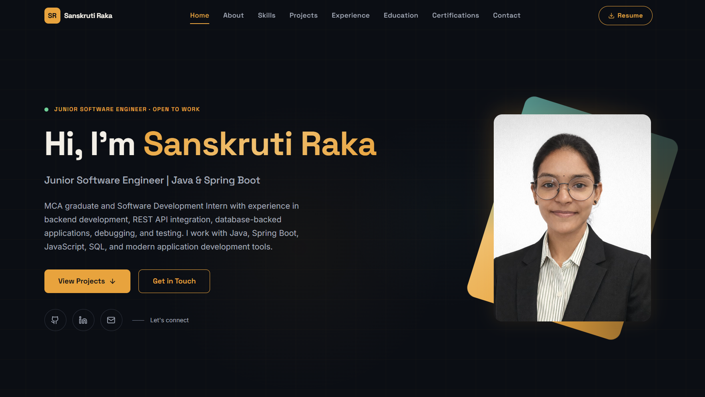

# Sanskruti Raka — Developer Portfolio

Personal developer portfolio for Sanskruti Raka, Junior Software Engineer specializing in Java, Spring Boot, REST APIs, and modern web application development.

**Live Demo:** [sanskruti-portfolio-nine.vercel.app](https://sanskruti-portfolio-nine.vercel.app/)

---



---

## Tech Stack

- **Frontend:** React 18, TypeScript, Vite
- **Styling:** Tailwind CSS, CSS Custom Properties
- **Motion & UI:** Framer Motion, Lucide React
- **Carousels:** Embla Carousel (`embla-carousel-react`, `embla-carousel-autoplay`)
- **Navigation & Visibility:** `react-scroll`, `react-intersection-observer`
- **Contact Service:** EmailJS (`@emailjs/browser`)

---

## Features

- **Hero Section:** Introduction, quick call-to-actions, and social links.
- **About:** Summary of background, technical strengths, and core metrics.
- **Skills Matrix:** Categorized technical skill groups (Backend, Databases, Frontend, Tools) with highlighted proficiencies.
- **Projects Showcase:** Interactive horizontal sliding carousel with standard laptop mockup frames, expandable tech stack chips, and direct links to GitHub repositories and live deployments.
- **Work Experience:** Chronological timeline covering software development internship deliverables and responsibilities.
- **Education:** Academic background from secondary school to MCA degree.
- **Certifications:** Verified training programs and job simulation completions with interactive preview modal.
- **Contact Form:** Client-side contact form powered by EmailJS, including client-side rate limiting and spam protection.

---

## Getting Started

### Prerequisites

- Node.js (version 18.x or later recommended)
- npm (version 9.x or later)

### Installation

1. Clone the repository:
   ```bash
   git clone https://github.com/Sanskrutiraka/sanskruti-portfolio.git
   cd sanskruti-portfolio
   ```

2. Install dependencies:
   ```bash
   npm install
   ```

3. Configure environment variables:
   Create a `.env` file in the root directory based on `.env.example`:
   ```bash
   cp .env.example .env
   ```
   Add your EmailJS credentials:
   ```env
   VITE_EMAILJS_SERVICE_ID=your_service_id
   VITE_EMAILJS_TEMPLATE_ID=your_template_id
   VITE_EMAILJS_PUBLIC_KEY=your_public_key
   ```

4. Start the development server:
   ```bash
   npm run dev
   ```
   Open `http://localhost:5173` in your browser.

5. Type check and build for production:
   ```bash
   npm run lint
   npm run build
   ```

---

## Project Structure

```
├── public/
│   ├── Docs/                  # Resume PDF and certification assets
│   ├── projects/              # Drop-in project screenshots (16:10 ratio)
│   ├── favicon.svg            # Site favicon
│   └── og-image.png           # Social preview image
├── src/
│   ├── components/            # Section components (Hero, About, Projects, etc.)
│   ├── App.tsx                # Main single-page application layout
│   ├── index.css              # Global styles, variables, and typography
│   └── main.tsx               # Application entry point
├── index.html                 # HTML template, SEO, and Open Graph tags
├── package.json               # Scripts and dependencies
└── vite.config.ts             # Vite configuration
```

---

## Deployment

The project is configured for deployment on Vercel.

1. Push changes to GitHub.
2. Import the repository in [Vercel](https://vercel.com).
3. Set the build command to `npm run build` and the output directory to `dist`.
4. Add the `VITE_EMAILJS_*` environment variables in the Vercel project dashboard.

---

## Contact

- **Email:** [sanskrutiraka1602@gmail.com](mailto:sanskrutiraka1602@gmail.com)
- **LinkedIn:** [linkedin.com/in/sanskruti-raka-105789261](https://www.linkedin.com/in/sanskruti-raka-105789261)
- **GitHub:** [github.com/Sanskrutiraka](https://github.com/Sanskrutiraka)

---

## License

MIT License. See [package.json](package.json).
